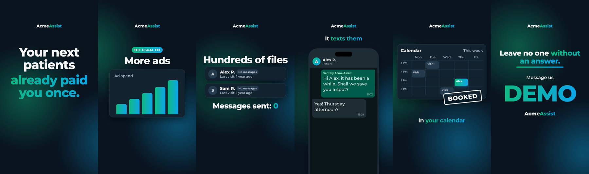
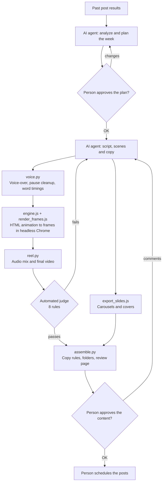
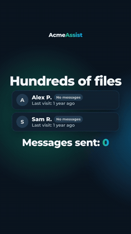
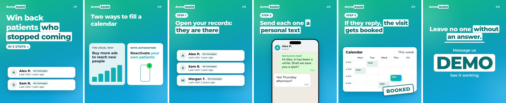
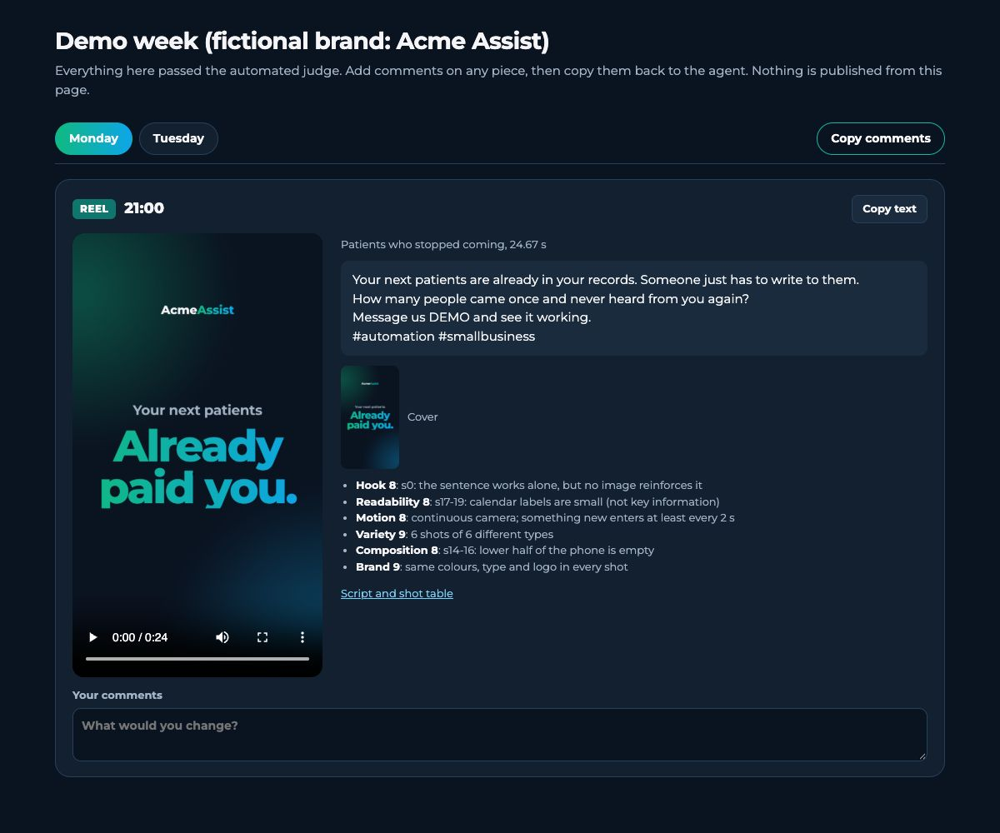

# AI Social Content Pipeline

An AI agent plans a week of social media content and builds the videos, carousels and posts. Code checks the work against fixed quality rules, and a person approves everything before it is published.



*Frames from a reel built by the demo. The brand (Acme Assist), the names and the numbers are all fictional.*

> **About this repository.** This is a public, sanitized version of a system I built for my own business and have used to create real videos and carousels. The tools and the workflow are real. The brand, the marketing content and the business data were removed and replaced with a fictional demo that runs on any machine, with no accounts or API keys.

## 1. Project Overview

The system produces one week of Instagram and LinkedIn content:

- **Short vertical videos (reels):** voice-over, animation, music and a cover image.
- **Image carousels:** step-by-step slides in 4:5 format.
- **LinkedIn posts:** written text that reuses the video from the day before.

[Claude Code](https://claude.com/claude-code) acts as the content team, following the playbook in [`CLAUDE.md`](CLAUDE.md). The Python and Node.js tools in this repository do the production work and enforce the quality rules.

## 2. Business Problem

Small businesses know they should publish regularly, but doing it well takes time they do not have. A single short video needs a script, a voice-over, animation, editing and a review. Agencies and video editors cost money, and generic AI tools tend to produce generic content, sometimes with made-up facts. The result is often an inconsistent social media presence.

## 3. Solution

The system splits the work according to what each part does best:

| Who | Does what | Why |
|---|---|---|
| **AI agent** | Analyzes past posts, writes scripts and copy, designs each scene | Creative work that needs judgment |
| **Code** | Measures timing, margins, motion and copy length, and blocks anything that breaks a rule | Rules that must hold every time |
| **Person** | Approves the weekly plan and the finished content, then schedules the posts | Final responsibility stays with a human |

The main design choice is that **the agent writes, the code verifies and the person decides.** The agent cannot approve its own work against the automated rules, and nothing is published automatically.

## 4. Technologies Used

| Area | Tools |
|---|---|
| AI agent | Claude Code, driven by a written playbook (`CLAUDE.md`) |
| Voice | ElevenLabs text-to-speech API (optional; the demo uses an offline stand-in) |
| Pipeline | Python (NumPy, Pillow), Node.js |
| Rendering | HTML, CSS and JavaScript animations; headless Chrome through `playwright-core` |
| Audio and video | FFmpeg |
| Quality | pytest, GitHub Actions, gitleaks (secret scanning) |

## 5. System Architecture



```text
├── CLAUDE.md            The agent's playbook: workflow, content rules, approval points
├── pipeline/            Production tools
│   ├── voice.py         Voice-over (mock or ElevenLabs), pause normalization, word timings
│   ├── reel.py          Video build and the automated judge
│   ├── assemble.py      Copy validation, final folders, review page
│   ├── render_frames.js HTML animation to video frames
│   ├── export_slides.js Slides and covers to PNG, with an overflow check
│   ├── preview.js       Quick composition check, without a full render
│   └── make_sounds.py   Generates the music and sound effects
├── engine/              Animation engine, design system and themes
├── demo/week/           Fictional demo content
├── tests/               Unit tests for the pipeline rules
└── scripts/run_demo.sh  Builds the whole demo with one command
```

## 6. Key Features

- **Text-synced animation.** Scenes are timed to the words in the script (`data-in="@the usual-0.1"`), so changing the voice-over does not mean re-timing the video by hand.
- **Automated video QA.** The judge inspects every frame and blocks the video if it breaks a rule (listed below).
- **Pause normalization.** `voice.py` measures real silence in the audio, rewrites pauses to a set length and remaps every word's timing to match.
- **Copy validation.** Captions and LinkedIn posts are checked for length, keyword, closing question, hashtags and emoji.
- **Themes for A/B testing.** The same scenes can render in dark, light or gradient themes. The demo uses all three.
- **Human review page.** One tab per day, with each piece, its scores and a comment box.
- **Paid API protection.** A voice-over is only requested again if the script changes.

### What the automated judge checks

| Rule | Reason |
|---|---|
| The hook is on screen in frame 0 | It is what people see while scrolling |
| At least 0.25 s on screen per word | Viewers must have time to read |
| Never still for 2 s | Still screens lose attention |
| Text stays inside safe margins | The Instagram interface covers the top and bottom |
| No silence over 0.5 s between sentences | Keeps the pace |
| 30 s maximum | Keeps each video to one idea |
| No two consecutive shots of the same type | Visual variety |
| The video ends on the call-to-action keyword | Every video has one clear next step |

The judge caught real problems while I built this demo. For example, it stopped the build because a message was visible for 2.93 s and needed 3.00 s.

## 7. How It Works

1. **Review.** The agent looks at how recent posts performed and proposes one change for the week.
2. **Plan.** It writes a proposal with each hook, script and shot. A person says OK or asks for changes.
3. **Build.** It writes the scenes, and the tools generate the voice-over, render each frame and mix the audio.
4. **Check.** The judge tests each video automatically. The agent then scores a contact sheet of the video by eye, and anything under 8 out of 10 gets fixed.
5. **Approve.** A person reviews everything on one page and leaves comments.
6. **Publish.** The person schedules the posts by hand, from an exact checklist.







## 8. Setup Instructions

The demo runs offline and needs no accounts or API keys.

**Requirements:** Python 3.10+, Node.js, FFmpeg and Google Chrome. Tested on macOS (Apple Silicon) with Python 3.14 and Node.js 24.

```bash
git clone <this-repository-url>
cd ai-social-content-pipeline

python3 -m venv .venv
.venv/bin/pip install -r requirements-dev.txt
npm ci

./scripts/run_demo.sh                  # about 1 minute
open demo/week/output/review.html      # on Linux: xdg-open
```

Run the tests with `.venv/bin/python -m pytest`.

**What the demo does and does not do.** It runs the real pipeline, but on content that is already written, so it makes no AI calls. The voice-over is a placeholder hum instead of speech, so the timing code runs without an account. The Claude Code agent is what writes content in real use, by following `CLAUDE.md`.

**To use a real voice,** copy `.env.example` to `.env`, add your own ElevenLabs key and voice ID, and run `VOICE_PROVIDER=elevenlabs ./scripts/run_demo.sh`.

## 9. Results

The private version of this system generates professional, ready-to-publish content:

- **Professional videos:** vertical 1080x1920 reels with a voice-over synced to the animation, music, sound effects, a custom cover and audio levels set for social media.
- **Professional carousels:** 4:5 step-by-step slides with consistent branding and a clear visual on every slide.
- **Consistent quality:** every video passes the automated judge and a visual review before a person sees it.

**No audience or business results are claimed.** The content has been created but not published yet, so there are no views, leads or revenue figures to report.

## Limitations

- Publishing is manual on purpose. The system does not connect to the Instagram or LinkedIn APIs.
- Looking at past results is a guided step for the agent, not an automated data pipeline.
- Video rendering depends on a local Chrome and FFmpeg installation.

## Credits

The bundled [Montserrat](https://github.com/JulietaUla/Montserrat) font is licensed under the [SIL Open Font License](assets/fonts/OFL.txt). The music and sound effects are generated by `pipeline/make_sounds.py`.
